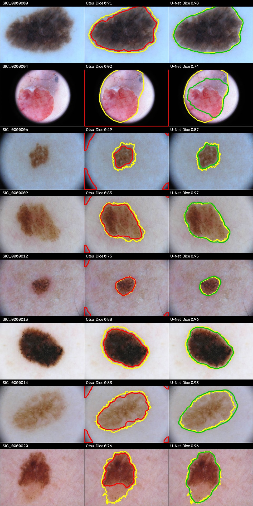
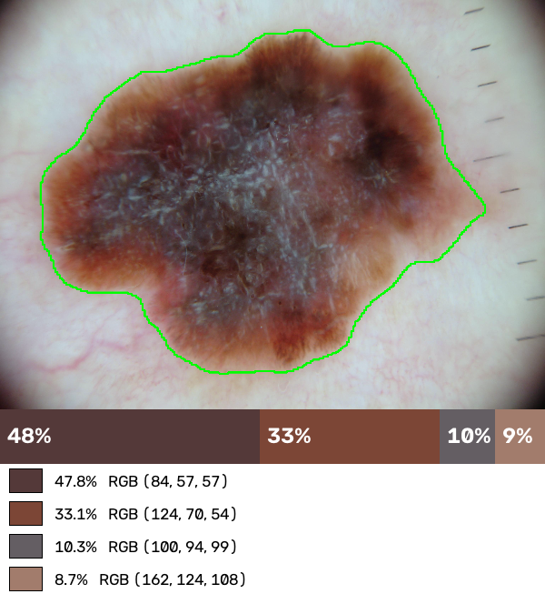
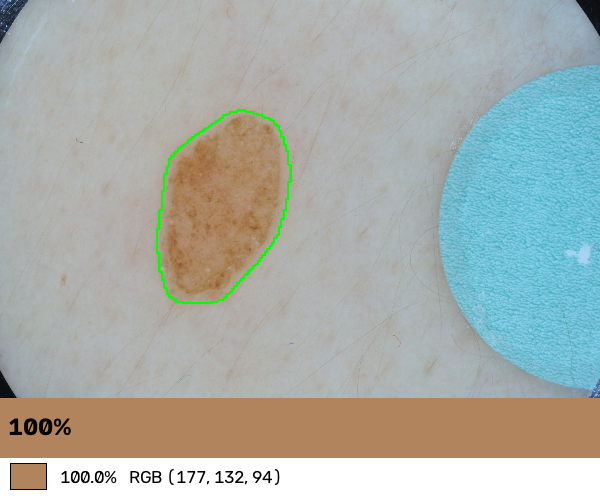
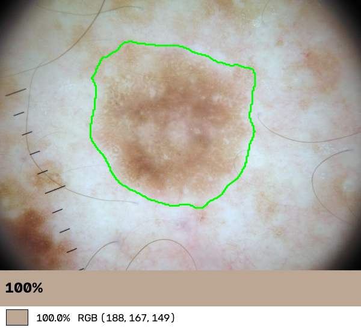
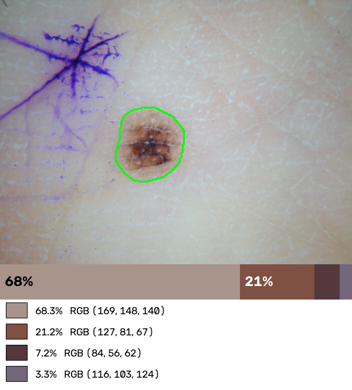
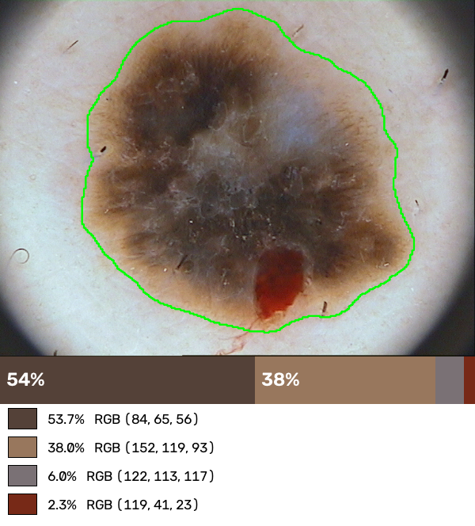
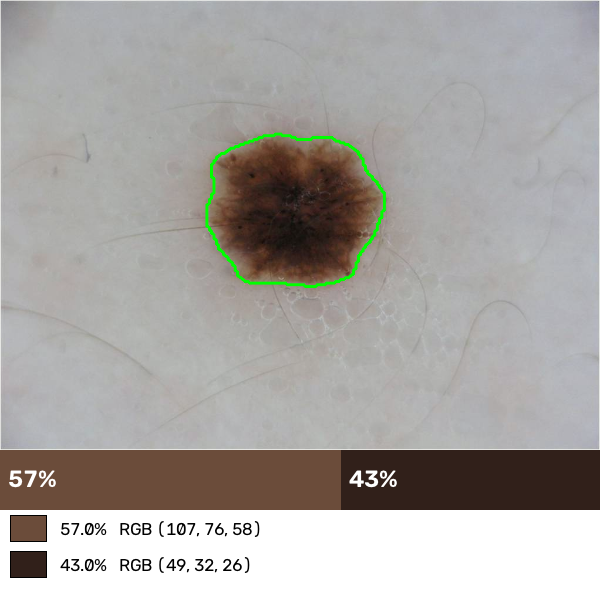

# Mole segmentation and colour analysis

A small project on dermoscopic images of skin lesions (ISIC 2018, Task 1). It segments the lesion, first with a classical method (Otsu thresholding) and then with a U-Net, and uses the resulting mask to measure the colours of the lesion.

This is a personal and educational project. It is not a diagnostic tool.

## Segmentation results

I compared the two methods on a test split of 389 images that were never used for training or for picking the best model.

| Method | Dice (mean ± std) | Dice (median) | IoU (mean) |
|---|---|---|---|
| Otsu (Lab lightness + morphology) | 0.554 ± 0.306 | 0.631 | 0.443 |
| U-Net, ResNet34 encoder | 0.894 ± 0.116 | 0.930 | 0.824 |

The U-Net gains about 0.34 Dice, and it is also much more regular: the standard deviation drops from 0.31 to 0.12, so there are far fewer complete failures. For reference, the validation Dice of the selected model was 0.903.

The Otsu baseline is deliberately simple. To evaluate quickly, it runs on images reduced to a quarter of their size, with a 15 px morphological kernel that I did not tune. A better-tuned classical method would score higher.



*Left to right: the image, Otsu, the U-Net. Yellow is the ground truth, red is Otsu, green is the U-Net. Images from ISIC 2018 (CC-BY-NC).*

## How the segmentation works

The baseline blurs the lightness channel of the image in Lab space, applies an inverted Otsu threshold (moles are darker than skin) and cleans the result with morphological opening and closing.

The model is a U-Net from `segmentation_models_pytorch` with a ResNet34 encoder pre-trained on ImageNet. It is trained on 256×256 images with a BCE + Dice loss, Adam (learning rate 1e-3, halved when the validation Dice stalls), 30 epochs and a batch size of 16, with flips, rotations and brightness/contrast changes as augmentation. Training ran on a free Colab GPU (see the notebook below). The ISIC training set (2,594 images with masks) is split 70/15/15 with a fixed seed. Dice and IoU are computed at the resolution of the original masks, with the same code for both methods.

## Colour analysis

Once a lesion is segmented, `analysis/color.py` measures it:

- mean and standard deviation of the colour in Lab, plus chroma and hue angle;
- the dominant colours, found with k-means in Lab and then merged when two colours are perceptually close (a ΔE threshold), so the number of colours depends on the lesion;
- the same statistics for the core and the periphery of the lesion;
- the contrast with the surrounding skin, measured on a ring around the lesion;
- optionally, a colour constancy step (Shades of Gray) to reduce differences in lighting between images;
- a detector for blue/green pen marks, whose pixels are left out of the measurements.

Each lesion gets a small report: the contour of the mask, the dominant colours as a proportional bar, and a legend.

<p align="center">
  
  
</p>
<p align="center">
  
  
</p>
<p align="center">
  
  
</p>

*Colour reports for six lesions, from the U-Net masks.*

### What I found on the test split

There is no ground truth for colour, so these results describe how the measurements behave, not whether they are correct.

The colour of the skin varies a lot from one image to another: the `b*` value of the skin in Lab is 9.2 ± 8.0, and some skins are clearly bluish. I first suspected the pen marks, since some images have blue marker strokes drawn around the lesion. I added a pen detector (it only covers part of the strokes), but the skin statistics barely changed. So the colour casts mostly come from how the images were taken, not from the markers.

Shades of Gray brings the images closer to each other: the standard deviation of the skin `b*` falls from 8.0 to 2.6. But the average skin colour also becomes almost grey (`b*` of about 0.5), so it removes real skin tint, and part of the reduced spread comes from the method itself. I only use it to compare images with each other, not to read absolute colours.

The number of dominant colours depends a lot on the settings. Most lesions are gradients of one brown, and k-means mainly splits them into lightness levels. This table shows how many lesions get each number of colours (389 images, no colour normalisation):

| Lightness weight | Mask erosion | 1 | 2 | 3 | 4 | 5 | 6+ |
|---|---|---|---|---|---|---|---|
| 1.0 | none | 30 | 106 | 112 | 69 | 49 | 23 |
| 0.5 | none | 97 | 169 | 85 | 31 | 5 | 2 |
| 0.5 | 3 % | 126 | 168 | 68 | 19 | 6 | 2 |

The weight given to lightness when merging colours has by far the largest effect. These numbers show how sensitive the count is, not which setting is right, so the count is only comparable between images analysed with identical settings.

## Running it

Python 3.10.

```bash
git clone https://github.com/AnnaSlr/mole-segmentation.git
cd mole-segmentation
pip install -r requirements.txt
```

The images are not in the repository (ISIC 2018 is CC-BY-NC). Download Task 1 from the [ISIC challenge site](https://challenge.isic-archive.com/), keeping Training Input and Training GroundTruth (2,594 images with masks), and arrange the files like this:

```
data/raw/ISIC2018/
├── images/   # ISIC_0000000.jpg ...
└── masks/    # ISIC_0000000_segmentation.png ...
```

The validation and test archives of the challenge are not used, because their masks are distributed separately.

Everything goes through `main.py`:

```bash
# Prepare the data
python main.py split                        # data/splits.json
python main.py preprocess                   # data/processed/ (256x256)

# Train (see below for a free GPU)
python main.py train --epochs 30 --batch-size 16

# Evaluate on the test split
python main.py evaluate-model               # Otsu vs U-Net on the same images
python main.py evaluate                     # Otsu alone, on the whole dataset

# One image
python main.py segment --input path/to/image.jpg    # Otsu
python main.py predict --input path/to/image.jpg    # U-Net
python main.py overlay --input path/to/image.jpg    # draw the mask contour
python main.py figure                               # image | Otsu | U-Net, saved in docs/

# Colour analysis (run predict on the same image first)
python main.py color --input path/to/image.jpg --normalize
python main.py color-batch                  # whole test split, one CSV row per image
python main.py inspect -n 5                 # reports for the most extreme cases
```

`color` reads the mask written by `predict` (`data/outputs/mask_unet.png` by default), so run `predict` on the same image first, or pass `--mask`.

Training on a CPU is far too slow to be practical (I estimate more than 20 minutes per epoch, from a small local test). I trained on a free Colab GPU with [`notebooks/colab_training.ipynb`](notebooks/colab_training.ipynb), which unzips the preprocessed data from Google Drive, trains the model and copies `best_model.pth` back to Drive. Put that file in `data/outputs/`.

There are a few unit tests, on small synthetic images (Dice and IoU, colour merging, pen detection, colour constancy). They need neither the dataset nor the model:

```bash
pip install pytest
pytest
```

## Project layout

```
├── main.py                   # command line entry point
├── segmentation/
│   ├── segment.py            # Otsu baseline
│   ├── metrics.py            # Dice, IoU
│   ├── evaluate.py           # Otsu evaluation
│   ├── split.py, preprocess.py, dataset.py
│   ├── model.py, train.py
│   ├── evaluate_model.py     # Otsu vs U-Net
│   ├── predict.py
│   ├── visualize.py          # mask contour overlay
│   └── figure.py             # comparison figure
├── analysis/
│   ├── color.py              # colour measurements and report
│   ├── batch.py              # colour analysis on a whole split
│   └── inspect_extremes.py   # reports for extreme cases
├── notebooks/
│   └── colab_training.ipynb
├── tests/
├── docs/                     # images used in this README
└── data/                     # not versioned, except splits.json
```

## Limitations

The split is random per image. ISIC contains several images of the same patient or lesion, and the metadata needed to split by patient is not in the archive I downloaded, so some leakage between training and test is possible.

The model works at 256×256 and its prediction is resized back to the original size, which limits the precision of the borders. Everything is evaluated on a single dataset: I did not test on another one such as PH2, or on smartphone photos, so I cannot say how well it generalises to other devices or skin tones. The training was not seeded, so a new run would give slightly different scores.

On the colour side, Shades of Gray assumes the average scene is grey, and it is not a real calibration. The pen detector uses HSV thresholds that I tuned by eye. The number of colours depends on empirical settings and has no clinical validation.

None of this is a medical device, and it must not be used to diagnose anything.

## References

- N. Codella et al., *Skin Lesion Analysis Toward Melanoma Detection 2018: A Challenge Hosted by the International Skin Imaging Collaboration (ISIC)*, arXiv:1902.03368.
- P. Tschandl, C. Rosendahl, H. Kittler, *The HAM10000 dataset*, Scientific Data 5, 180161 (2018).
- [`segmentation_models_pytorch`](https://github.com/qubvel-org/segmentation_models.pytorch) for the U-Net implementation.
